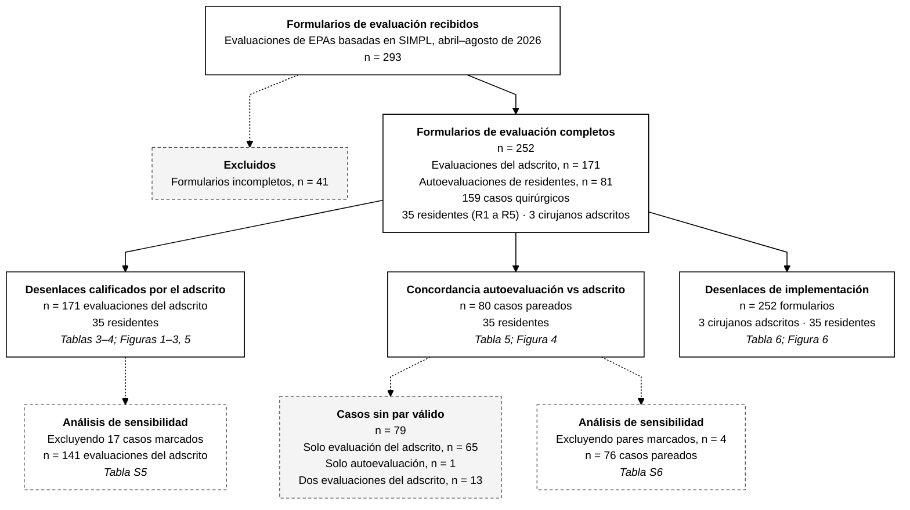

# Diagrama de flujo del estudio

**Figura. Diagrama de flujo del estudio**

Flujo de formularios de evaluación, casos quirúrgicos y residentes en el estudio (abril–agosto de 2026). Los recuadros continuos muestran las muestras analíticas y las tablas y figuras que las usan; los recuadros discontinuos muestran exclusiones y análisis de sensibilidad. Los casos marcados se identificaron durante la verificación de datos (dos formularios del adscrito en un caso, formularios de distintos residentes bajo un mismo número de caso, discrepancia de procedimiento, abordaje o fecha entre formularios pareados, o codificación inconsistente del evaluador). Abreviaturas: EPA, actividad profesional confiable; R1–R5, residente de primer a quinto año; SIMPL, System for Improving and Measuring Procedural Learning.

## Conteos usados en el diagrama

|Paso                                                            |   n|
|:---------------------------------------------------------------|---:|
|Formularios recibidos                                           | 293|
|Excluidos: formularios incompletos                              |  41|
|Formularios completos                                           | 252|
|Evaluaciones del adscrito                                       | 171|
|Autoevaluaciones de residentes                                  |  81|
|Casos quirúrgicos                                               | 159|
|Residentes                                                      |  35|
|Cirujanos adscritos                                             |   3|
|Casos pareados (1 adscrito + 1 autoevaluación, mismo residente) |  80|
|Casos con solo evaluación del adscrito                          |  65|
|Casos con solo autoevaluación                                   |   1|
|Casos con dos evaluaciones del adscrito                         |  13|
|Otros casos sin par                                             |   0|
|Casos marcados                                                  |  17|
|Evaluaciones del adscrito tras excluir casos marcados           | 141|
|Casos pareados tras excluir casos marcados                      |  76|

_Generado el 2026-10-17 19:24 a partir de EPA_SIMPL_Database.xlsx. Los formularios incompletos (n = 41) se capturan manualmente en EPA_Flowchart.R._
